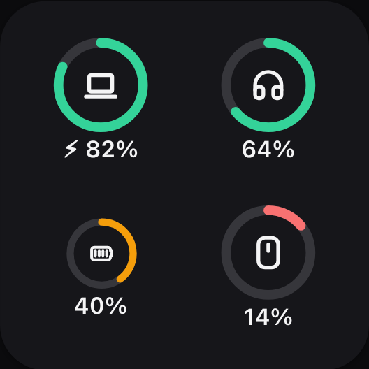

# Batteries

Battery levels on one tile. macOS only.

- **This Mac:** percent, charging, and the time left when macOS has an estimate. A Mac without a battery shows only devices.
- **Magic Keyboard, Mouse and Trackpad**, and other Bluetooth devices that tell macOS their level.
- **AirPods:** one ring or row, showing the lower of the two sides. The list style gives left (L), right (R) and case under the bar. "L+R" means both sides are the same. With one earbud in, only that side is shown. The unnamed "Bluetooth Device" macOS also lists for the case is not shown twice.
- An owner's name after an Apple model name, as in "AirPods Pro nam99", is left out.

The Mac comes first, then the other devices from the lowest level up. A device that is not connected is hidden. A device that does not report a level to macOS cannot be shown. The tile refreshes every 60 seconds.

Green is above 50%, amber from 20% to 50% and red below 20%.

- **Headphones that tell their level to nothing else** (many Sony models, for example) are read from macOS's Bluetooth framework.

## Access

`shell`: `pmset -g batt`, `ioreg -r -c AppleDeviceManagementHIDEventService -l`, `system_profiler SPBluetoothDataType -json`, and a short `osascript` (JavaScript) that asks macOS's Bluetooth framework for the levels of connected devices. All four only read. The output of `ioreg` and `system_profiler` includes device addresses and serial numbers: the plugin does not save, log or send them. Only names and levels go to the phone.

The first time, macOS may ask whether Nookdeck may use Bluetooth. If you refuse, or the question is left unanswered, the other three still work; only devices that tell their level through the framework alone are missing.

## Tile settings

**Style**: `auto` (default) goes by the tile's size. Pick another to override it.

| Style | `auto` uses it on | Shows |
|---|---|---|
| `rings` | 2x2 | A ring for each device: its icon inside, its level under it, and a bolt while charging. Three or four rings make a 2x2 grid. When there is room, the AirPods case has a small ring of its own. At most four devices; the rest are counted. |
| `row` | 2x1, 4x2 | The same rings in one row (three at most on a tile two cells wide). |
| `list` | never | Name, percent and a bar for each device, with a second line such as "Charging" or "L 64 · R 71 · Case 40". A 2x2 tile fits three devices. |
| `lowest` | 1x1 | One ring for the lowest battery. |

**Show this Mac's battery**: turn it off to show only accessories.

Needs Nookdeck 0.5.1 or later.
