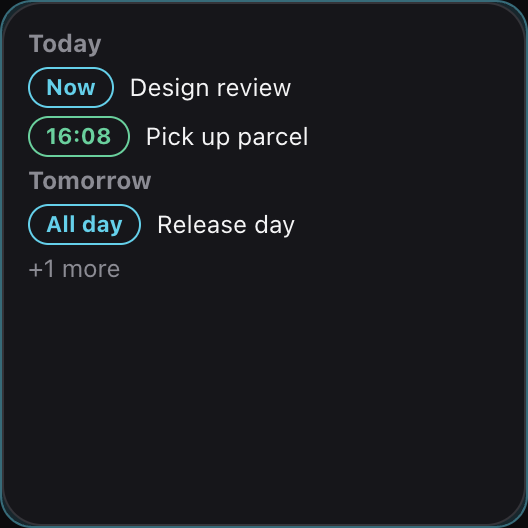

# Calendar

Your next events on one tile. Works on macOS, Windows and Linux.

- Today's and the next events under **Today**, **Tomorrow**, **This week**, **Next week** and **Later**, each with its time and title.
- Up to four calendars. Each has its own colour on the tile: calendar 1 uses the theme's accent colour, 2 its "ok" colour, 3 its "warning" colour and 4 its "bad" colour.
- Repeating events (with removed, moved and cancelled occurrences), all-day events and events over several days.
- Times are shown in the computer's time zone. The tile is read only.

## Which links work

| Calendar | Where to copy the link |
|---|---|
| Google Calendar | Settings, pick the calendar, **Integrate calendar**, **Secret address in iCal format** |
| iCloud | Calendar app, share the calendar, turn on **Public Calendar**, copy the link (`webcal://` is fine) |
| Outlook | Outlook on the web, Settings, Calendar, **Shared calendars**, **Publish a calendar**, copy the **ICS** link |

**Only these three services work.** The link's host must be `calendar.google.com`, `*.icloud.com`, `outlook.live.com`, `outlook.office365.com` or `outlook.office.com`. Nextcloud, Fastmail, a company server and any other address are refused with a message on the tile. A Nookdeck plugin names the sites it may reach when it is installed, and cannot add one from a setting.

## Settings

Paste each link into the plugin's settings on your computer.

| Setting | Default |
|---|---|
| Calendar 1 to 4: ICS link | empty |
| Days ahead (1 is today only, up to 31) | 7 |
| First day of the week (where "Next week" begins) | Monday |
| 24-hour clock | on |

Each tile also has **Events on the tile** (1 to 8, default 4). Lower it for a small tile.

## Privacy

**Anyone who has an ICS link can read that calendar.** Treat it like a password.

- The links are secret settings. They stay on your computer, are never shown again in the settings page, and are never sent to the phone, written to a log or shown in an error.
- The phone gets event times and titles only. Descriptions, places, guests and meeting links stay on the computer.
- Calendars are read every 10 minutes and kept in memory only.
- To stop a link from working, reset it in the calendar service.

## Access

`network`, to the five hosts above only.

## Limits

- A calendar file may be at most 5 MB.
- Repeats by the hour or finer, by week number or by day of the year show their first date only. A change to "this and all following events" saved as a single override applies to that one date only.
- If a calendar cannot be loaded, the tile keeps the last copy and says so.
