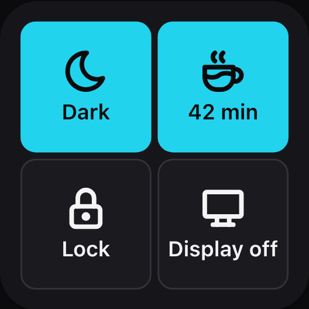

# Mac controls

Everyday Mac switches on the phone. macOS only.

| Button | What it does |
|---|---|
| Appearance | Shows Dark or Light; tap to switch. The **Dark mode** action can also set one of them. |
| Keep awake | Keeps the Mac and its display awake for the tile's number of minutes (0: until you turn it off). While it is on, the button shows the time left, and a 4x2 tile also shows it as a ring. Tap again to stop. |
| Lock | Locks the screen (the system's Control + Command + Q). |
| Display off | Puts the display to sleep. |

Each one is also an action you can put on a normal button.

## Access

`shell` and `storage`. The plugin only runs these, with nothing typed by you inside them except the checked number of minutes:

- `osascript` to read the appearance, to change it and to lock the screen
- `caffeinate -d` for Keep awake, and `kill` to stop the one it started
- `pmset -g assertions` to see whether that one is still running, and `pmset displaysleepnow`

It saves one thing: the process id and end time of its own `caffeinate`. It never stops a `caffeinate` that another app started. Keep awake ends when Nookdeck quits.

## macOS permissions

macOS asks the first time, **on the Mac**. If you do not allow it, the phone shows which one is missing.

| Button | Where to allow Nookdeck (System Settings, Privacy & Security) |
|---|---|
| Appearance | **Automation**: System Events |
| Lock | **Automation**: System Events, and **Accessibility** |
| Keep awake, Display off | nothing to allow |

Reading the appearance needs no permission.

If **Lock** only turns the screen off without asking for a password afterwards, set **Require password** under System Settings, Lock Screen.

On a 1x1 tile there is one big button: Dark mode, or the one chosen under **On a 1x1 tile, show**.

Needs Nookdeck 0.5.1 or later.
