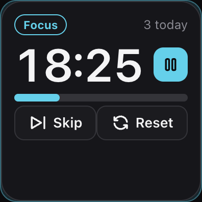

# Pomodoro

A focus timer on one tile. Works on macOS, Windows and Linux.

- The time left, a progress bar, and how many focus blocks you finished today.
- A play / pause button beside the time, **Skip** (to the other phase) and **Reset** (this phase from the top). A 2x1 tile has room for the time and play / pause only. Each one is also an action you can put on a normal button.
- When a phase ends, the next one waits for you to press Start. There is no sound.

The timer runs on the computer, so it keeps time while the phone sleeps or is closed. It saves the time each phase ends, so it is still right after Nookdeck or the computer restarts. The tile updates every second only while a phase is running.

A focus block counts when its time runs out, on the day it ends. A skipped or reset block does not count.

## Settings

| Setting | Default |
|---|---|
| Focus (minutes) | 25 |
| Break (minutes) | 5 |

1 to 180 minutes. They are the same for every Pomodoro tile: there is one timer. A new length applies from the next phase you start.

## Access

`storage` only: the timer's state and the number of finished blocks per day, for the last 30 days. No network, no commands.
