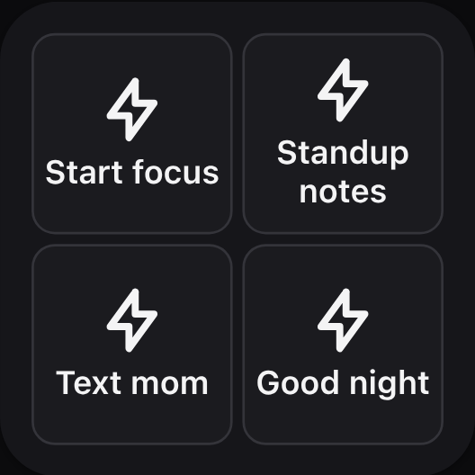

# Apple Shortcuts

Run your Apple Shortcuts from the phone. macOS only.

- **Shortcuts** tile (a card): your shortcuts as buttons. Show all of them, one folder, or only the names you list.
- **Run a shortcut** action: put one shortcut on any normal button. Type its name as it appears in the Shortcuts app.

## Access

`shell`: the plugin runs one command, `/usr/bin/shortcuts` (`list` and `run`). A name is passed as a single quoted argument after `--`, so spaces, quotes, `$`, emoji and names that start with `-` run as they are written.

What a shortcut itself does is up to the shortcut. The first time one needs a permission, macOS asks **on the Mac**: run it there once and allow it.

## Tile settings

| Setting | Notes |
|---|---|
| Folder | The folder's name in the Shortcuts app. Empty shows all shortcuts. A name that does not exist shows an error. |
| Or only these names | Separated by commas, shown in this order. This wins over Folder. For a name that contains a comma, use a folder. |
| Buttons per row | `auto` (default) goes by the tile: two on 2x1 and 2x2, three on 4x2. Or 1 to 6. |
| Most buttons to show | 0 (default) fills the tile: 2 on 2x1, 4 on 2x2, 6 on 4x2. Or up to 24. The rest are counted under the buttons on tiles three or more cells high. |

The list is read at most once a minute.

## When a shortcut fails or takes long

A failed shortcut shows its message on the phone. Nookdeck waits 15 seconds; a longer shortcut keeps running on the Mac, and its later errors are not reported. A shortcut that asks a question waits for the answer on the Mac.

## Recipes

macOS has no command for these, but Shortcuts does. Create each shortcut in the Shortcuts app, then add it here by name.

### Do Not Disturb or another Focus

1. New shortcut, name it **Focus on**.
2. Add the action **Set Focus**. Set it to *Turn* **Do Not Disturb** *On* until **Turned Off**.
3. Make a second one, **Focus off**, with *Turn* **Do Not Disturb** *Off*.

Choose any other Focus (Work, Sleep) in the same action. For a single button, set the action to **Toggle**.

### Display brightness

1. New shortcut, name it **Bright**.
2. Add the action **Set Brightness** and drag it to 100%.
3. Copy it as **Dim** at 20%.

**Set Brightness** changes the Mac's own display. Most external monitors do not follow it.

Each button shows one icon above the name; long names take two lines. macOS does not give the shortcut's own color and icon to this plugin.

Needs Nookdeck 0.5.1 or later.
